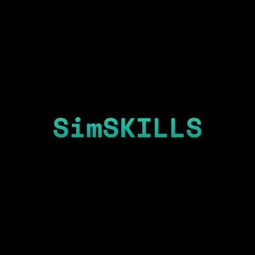

  

# SimSkills 🚀
**Escape Tutorial Hell. Build Real Software.**

SimSkills is an advanced AI-powered career simulation platform designed for developers/students who want mastery, not hand-holding. It generates personalized career roadmaps, acts as a brutal Senior Engineer during code reviews, and provides a full cloud-based IDE for hands-on practice.

---

## 🔥 Key Features

### 🧠 AI-Architected Roadmaps
Stop guessing what to learn. Whether you want to be a **Frontend Wizard**, **Cybersecurity Analyst**, or **AI Engineer**, SimSkills instantly generates a comprehensive, level-by-level curriculum tailored to your experience.

### 💻 Cloud IDE Integration
Code directly in the browser with a VS Code-like environment (Monaco Editor).
- **Multi-file support**: Build complex projects.
- **Auto-save**: Never lose your progress.
- **Instant Execution**: Run JS/Web code instantly.

### 💀 "Brutal" AI Grading
Our AI doesn't pat you on the back. It acts as a strict **Senior Principal Engineer**.
- **Security Audits**: Detects vulnerabilities.
- **Code Hygiene**: Critiques naming conventions and structure.
- **Optimization**: Demands efficiency.
*Feedback is harsh, but it makes you better.*

### 🐞 Bug Hunter Mode
Test your debugging skills against the clock.
- Get a broken code snippet related to your career path.
- Find the bug, fix it in the IDE, and verify with AI.
- Earn XP and maintain your daily streak.

### 🏆 Gamified Progression
- **XP & Levels**: Grind your way from Junior to Architect.
- **Streaks**: Build consistency with daily challenges.
- **Profile Customization**: Show off your title and achievements.

---

  Built with ❤️ for students who want to be elite.

